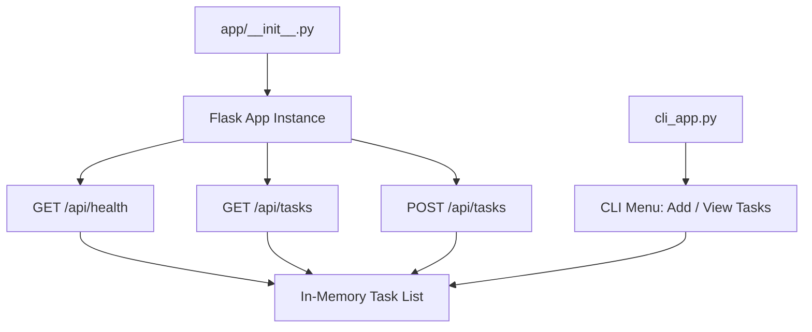

# Architecture — Current Sprint: Sprint 1

> **Living document.** Updated each sprint. See `docs/checkpoints/` for snapshots.  
> **Last updated:** S1_1

---

## Application Structure

## Key Design Decisions — Sprint 1

* Flat single-module design — modularization via Blueprints introduced Sprint 2
* In-memory storage — JSON file persistence introduced Sprint 2
* CLI available for manual verification — deprecated Sprint 4
* App factory pattern (`create_app()`) established from day one

> See `docs/living/sprint_plan.md` Section 5 for full technical design rationale.
