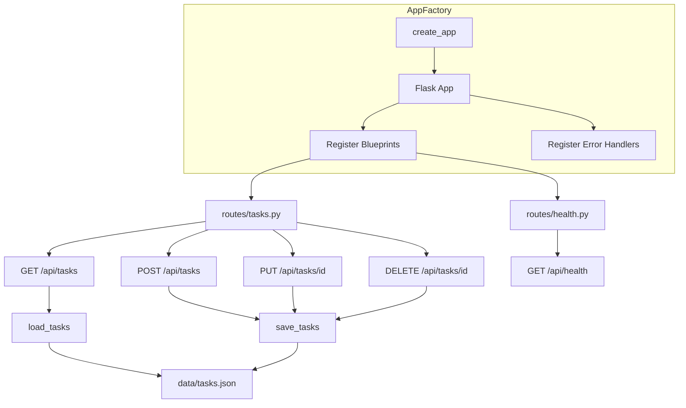

# Architecture — Current Sprint: Sprint 2

> **Living document.** Updated each sprint. See `docs/checkpoints/` for snapshots.  
> **Last updated:** S2_1

---

## Sprint 1 → Sprint 2 Evolution

Sprint 2 refactors the monolithic Sprint 1 design into a modular, persistent system.

### Sprint 1 State (Before Refactoring)
```
app/__init__.py → Flask routes → In-Memory List
```

### Sprint 2 Architecture



## Key Changes from Sprint 1 to Sprint 2

| Aspect | Sprint 1 | Sprint 2 |
|--------|----------|----------|
| **Routing** | Monolithic `app/__init__.py` | Modular Blueprints |
| **Storage** | In-memory list | JSON file |
| **App init** | Direct Flask creation | Factory pattern `create_app()` |
| **Error handling** | Flask defaults | Global `@errorhandler` |
| **Test organization** | Flat `tests/` | Modular subfolders |
| **API endpoints** | GET, POST | + PUT, DELETE |
