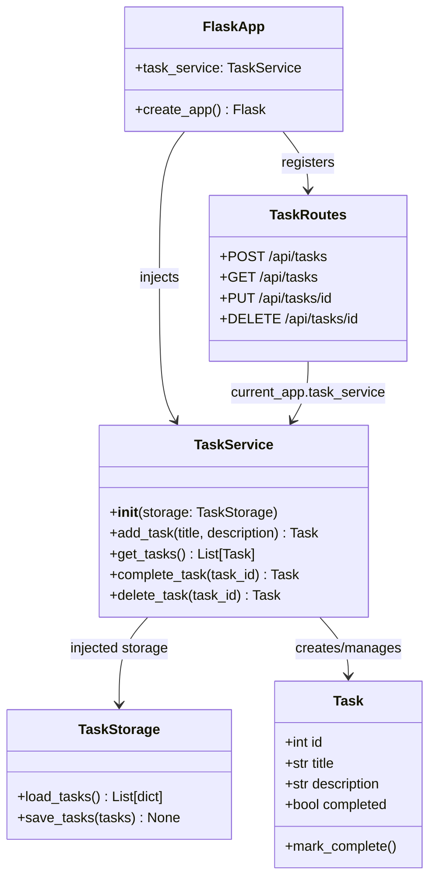

# Class Diagram — Current Sprint: Sprint 3

> **Living document.** Updated when architecture changes. See `docs/checkpoints/` for snapshots.  
> **Last updated:** S3_1

---

## Key Relationships

| Relationship | From | To | Type |
|-------------|------|----|------|
| Injection | `FlaskApp` | `TaskService` | Dependency Injection |
| Usage | `TaskRoutes` | `TaskService` | Association |
| Delegation | `TaskService` | `TaskStorage` | Composition |
| Creation | `TaskService` | `Task` | Association |

## Notes

- `TaskStorage` is injected into `TaskService` constructor
- Routes never import `TaskStorage` or `TaskService` directly — access via `current_app`
- `Task` class replaces plain Python dictionaries used in Sprint 2
- `MockTaskService` (used in tests) substitutes for `TaskService` without file I/O
