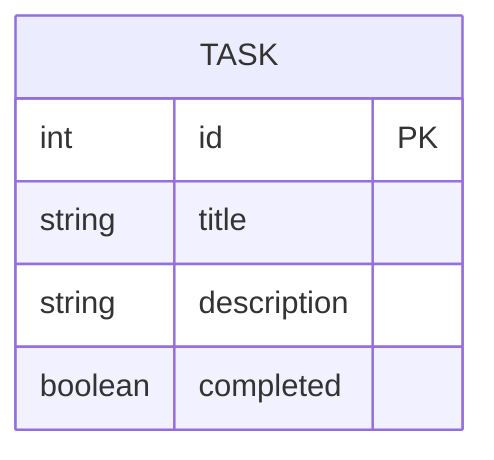

# ERD (Entity Relationship Diagram) — Current Sprint: Sprint 3

> **Living document.** Updated when data model changes. See `docs/checkpoints/` for snapshots.  
> **Last updated:** S3_1

---

> **Note:** Sprint 3 uses JSON file storage. This ERD defines the data model
> that will guide Sprint 4 database schema design.

## Field Definitions

| Field | Type | Required | Notes |
|-------|------|----------|-------|
| `id` | int | Yes | Auto-assigned, unique |
| `title` | string | Yes | Cannot be empty |
| `description` | string | No | Optional |
| `completed` | boolean | Yes | Defaults to `false` |

## Sprint 4 Preview

When database integration is introduced in Sprint 4, this ERD will map directly
to a database table. The `Task` class attributes will become SQLAlchemy model
columns with minimal changes.
